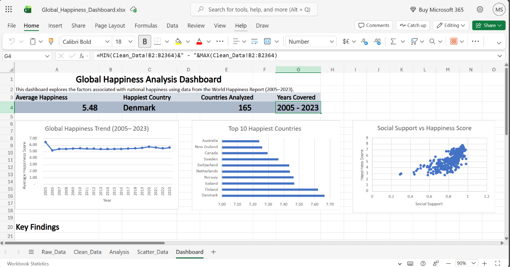

# 🌍 Global Happiness Excel Dashboard

## 📌 Project Overview

This project analyzes **global happiness trends and well-being indicators** using data from the World Happiness Report covering the period from **2005 to 2023**.

The goal of the project was to explore how happiness differs across countries and over time, identify factors associated with higher happiness levels, and transform the analysis into an interactive **Microsoft Excel dashboard**.

The project combines data preparation, calculated metrics, Pivot Tables, KPI development, and data visualization to communicate the main findings in a clear and accessible way.

---

## 📊 Dashboard Preview



The dashboard provides a high-level overview of global happiness and allows users to explore long-term trends, compare countries, and examine relationships between happiness and selected well-being indicators.

---

## 🎯 Business Questions

The analysis focuses on four main questions:

1. How has global happiness changed over time?
2. Which countries report the highest average happiness?
3. Which factors show the strongest relationship with happiness?
4. How do countries differ across different Happiness Tiers?

---

## 📂 Dataset

| Attribute | Value |
|---|---|
| Source | World Happiness Report |
| Time Period | 2005–2023 |
| Countries | 165 |
| Observations | 2,364 |

The dataset contains country-level observations of happiness together with several social and economic indicators.

These variables make it possible to compare countries and investigate which factors tend to be associated with higher levels of reported happiness.

---

## 🧹 Data Preparation

Before building the dashboard, the dataset was cleaned and transformed in Excel.

The preparation process included:

- data validation;
- checking the structure and consistency of the dataset;
- creation of a **Happiness Tier** classification;
- creation of a **Quality of Life Index**;
- creation of an **Emotional Balance Score**;
- KPI calculations;
- creation of Pivot Tables;
- preparation of supporting analysis for the dashboard.

This transformed the raw dataset into a structured analytical model suitable for reporting and visualization.

---

## 📈 Analytical Approach

The project follows a simple analytical workflow:

**Raw Data → Data Preparation → Calculated Metrics → Pivot Tables → Analysis → Dashboard → Insights**

The analysis combines country comparisons, long-term trends, and relationships between happiness and well-being indicators.

---

## 📊 Dashboard Features

The dashboard includes several KPIs and visualizations designed to answer the main analytical questions.

### KPI Cards

- **Average Happiness**
- **Happiest Country**
- **Countries Analyzed**
- **Years Covered**

### Visualizations

- **Global Happiness Trend**  
  Shows how average happiness changed throughout the analyzed period.

- **Top 10 Happiest Countries**  
  Compares countries with the highest average happiness levels.

- **Social Support vs Happiness**  
  Explores the relationship between social support and reported happiness.

- **Social Support and Freedom by Happiness Tier**  
  Compares selected well-being indicators across different groups of countries.

---

## 🔍 Key Insights

### 1. Social support is strongly associated with happiness

Countries with stronger social support generally report higher levels of happiness.

The relationship suggests that social and community factors are an important part of overall well-being and should be considered alongside traditional economic indicators.

---

### 2. Nordic countries consistently perform strongly

Nordic countries appear among the highest-performing countries in the happiness comparison.

Their strong results indicate that high happiness levels are associated with a combination of social, economic, and quality-of-life factors rather than one isolated variable.

---

### 3. Higher Happiness Tiers perform better across multiple indicators

Countries classified in the higher Happiness Tiers tend to show stronger results across several well-being indicators.

This suggests that high happiness is multidimensional and is associated with a broader combination of favorable conditions.

---

### 4. Global happiness is relatively stable over time

Average global happiness did not show dramatic long-term changes during the analyzed period.

However, the overall average can hide substantial differences between individual countries.

For this reason, global trends should be analyzed together with country-level comparisons.

---

## 💡 Business & Policy Implications

Although happiness is not a traditional business KPI, the analysis demonstrates how social and economic data can support broader decision-making.

### Strengthen social support

The relationship between social support and happiness suggests that policies and initiatives that strengthen social connections and access to support may contribute to higher well-being.

### Look beyond economic indicators

Economic performance alone does not provide a complete picture of quality of life.

Organizations and policymakers can benefit from monitoring social and well-being indicators alongside traditional economic measures.

### Monitor long-term trends

Tracking happiness over time can help identify meaningful changes that may not be visible from a single-year comparison.

### Use multiple indicators

Happiness should be analyzed as a multidimensional outcome rather than as the result of one individual factor.

---

## 🛠 Tools & Techniques

### Microsoft Excel

The project was developed primarily in **Microsoft Excel**.

Techniques used include:

- Pivot Tables
- Pivot Charts
- Calculated Fields
- KPI calculations
- Scatter Plots
- Data Transformation
- Dashboard Design
- Interactive reporting

---

## 🚀 Skills Demonstrated

This project demonstrates practical skills in:

- Data Cleaning
- Data Transformation
- Exploratory Data Analysis
- Pivot Table Analysis
- KPI Design
- Dashboard Development
- Data Visualization
- Analytical Thinking
- Data Storytelling
- Translating analysis into actionable insights

---

## ⚠️ Limitations

Several limitations should be considered when interpreting the results:

- The analysis identifies **associations**, not causal relationships.
- Country-level averages may hide differences between population groups.
- Data availability varies across countries and years.
- Global averages can hide substantial country-level variation.
- The dashboard provides a high-level analytical view and does not capture every factor that may influence individual well-being.

---

## 🚀 Possible Future Improvements

The project could be extended by:

- adding regional comparisons;
- comparing happiness trends across continents;
- analyzing changes before and after major global events;
- expanding correlation analysis across additional indicators;
- adding more interactive filtering options;
- developing the analysis further in Power BI or Tableau.

---

## 📁 Repository Structure

```text
global-happiness-excel-dashboard/
│
├── Global_Happiness_Dashboard.xlsx
├── dashboard-preview.png
├── README.md
└── LICENSE
```

---

## 📥 How to Explore the Project

The complete interactive dashboard is available in the Excel workbook:

**[`Global_Happiness_Dashboard.xlsx`](Global_Happiness_Dashboard.xlsx)**

To explore the project:

1. Download the Excel workbook.
2. Open it in Microsoft Excel.
3. Navigate to the **Dashboard** worksheet.
4. Explore the dashboard and KPI cards.
5. Review the supporting worksheets to see the underlying analysis.

---

## About This Project

This project was created as part of my **Data Analytics portfolio**.

The goal was not only to build an Excel dashboard, but also to practice the complete analytical workflow — from preparing and transforming data to identifying patterns and communicating the results through an interactive dashboard.
